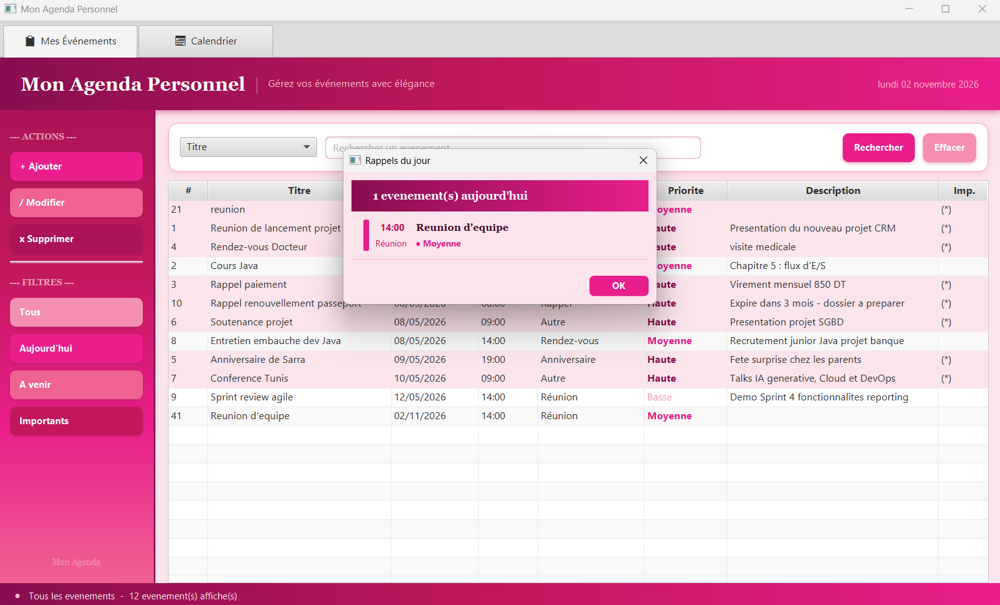
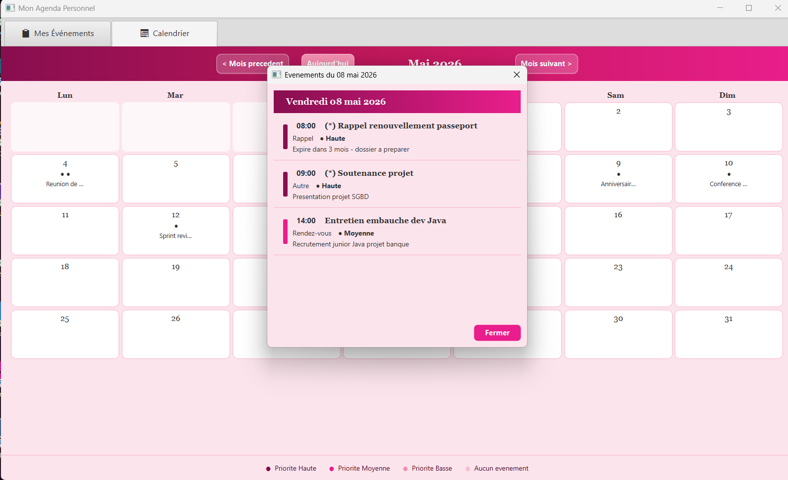
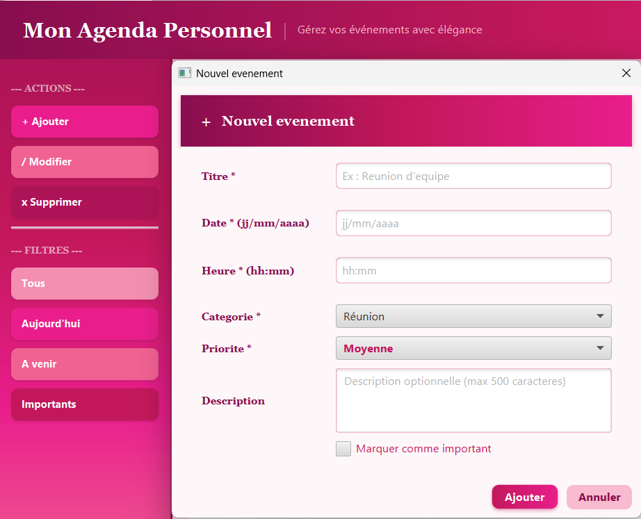

# 📅 MonAgendaPersonnel

### ✨ A JavaFX Desktop Application for Personal & Professional Event Management

<p align="center">
  <strong>Organize your schedule. Manage your events. Stay productive.</strong>
</p>

---

## 🌟 About the Project

**MonAgendaPersonnel** is a desktop application developed in Java 17 using JavaFX. It helps users organize their personal and professional activities through an interactive calendar and an intuitive graphical interface.

The application provides tools to create, manage, search, and organize events while keeping track of important dates and priorities.

🎓 **Academic Project** — Developed as part of the Business Computing degree at ISG Tunis.

## 🚀 Key Features

### 📝 Event Management
- Create, view, update, and delete events (CRUD).
- Manage event details, including title, date, time, description, and category.
- Assign priorities to events: High, Medium, and Low.
- Mark important events.

### 🔍 Search & Filtering
- Search events using multiple criteria:
  - Title
  - Date
  - Category
  - Priority
- Filter events by:
  - All events
  - Today's events
  - Upcoming events
  - Important events

### 🗓️ Interactive Calendar
- Monthly calendar visualization.
- Navigate between months.
- Visual indicators for event priorities.
- Easily view scheduled activities.

### 🔔 Reminders & Validation
- Automatic daily event reminders at application startup.
- Real-time form validation to improve data accuracy.

### 🎨 User Interface
- JavaFX graphical interface.
- Dark and colored themes.
- Dedicated interfaces for event management and calendar navigation.

## 🛠️ Technologies & Tools

| Category | Technologies |
|---|---|
| Programming Language | Java 17 |
| GUI Framework | JavaFX |
| Database | Oracle Database |
| Database Connectivity | JDBC |
| Query Language | SQL |
| IDE | NetBeans |
| Build Tool | Apache Ant |

## 🏗️ Architecture

The application follows a **Three-Layer Architecture**, separating the user interface, business logic, and database operations.

```text
MonAgendaPersonnel
│
├── Presentation Layer
│   └── JavaFX GUI
│
├── Business Logic Layer
│   └── Event Management
│
└── Data Access Layer
    └── JDBC + Oracle Database
```

### 📦 Main Packages

- `monagenda.model` — Event entity and data model.
- `monagenda.gestion` — Event management operations and business logic.
- `monagenda.gui` — JavaFX interfaces and calendar views.
- `monagenda.util` — Database connection utilities.

## 🗄️ Database

The application uses **Oracle Database** to store event information.

The `EVENEMENTS` table contains:

| Field | Description |
|---|---|
| ID | Unique event identifier |
| TITRE | Event title |
| DATE_EVENEMENT | Event date |
| HEURE_EVENEMENT | Event time |
| DESCRIPTION | Event description |
| TYPE_EVENEMENT | Event category |
| IMPORTANT | Important event indicator |
| PRIORITE | Event priority |

The database creation script is available in:

`database/database.sql`

## ⚙️ Installation & Configuration

### 1. Clone the Repository

```bash
git clone https://github.com/fatmabenhamouda/MonAgendaPersonnel.git
```

### 2. Open the Project

Open the cloned project in **NetBeans IDE**.

### 3. Configure Java and JavaFX

Make sure Java 17 and the required JavaFX libraries are configured in your environment.

### 4. Configure Oracle Database

Create the database table by executing:

```text
database/database.sql
```

Configure the following environment variables on your system:

- `DB_URL` — Oracle database connection URL.
- `DB_USER` — Oracle database username.
- `DB_PASSWORD` — Oracle database password.

Example of a database URL:

```text
jdbc:oracle:thin:@localhost:1521:XE
```

Use the connection URL corresponding to your Oracle Database installation.

### 5. Add the Oracle JDBC Driver

Add `ojdbc11.jar` to the project's libraries in NetBeans.

### 6. Build and Run

Build and run the project from NetBeans.

## 📸 Application Screenshots

### 🏠 Main Dashboard


### 🗓️ Interactive Calendar


### 📝 Event Management


## 👩‍💻 Contributors

- **Fatma Ben Hamouda**
- **Nour Almia**

## 📌 Project Information

- **Project:** MonAgendaPersonnel
- **Version:** 2.0
- **Date:** May 2026
- **Type:** Java Desktop Application
- **Institution:** ISG Tunis

---

⭐ If you find this project interesting, feel free to explore the repository!